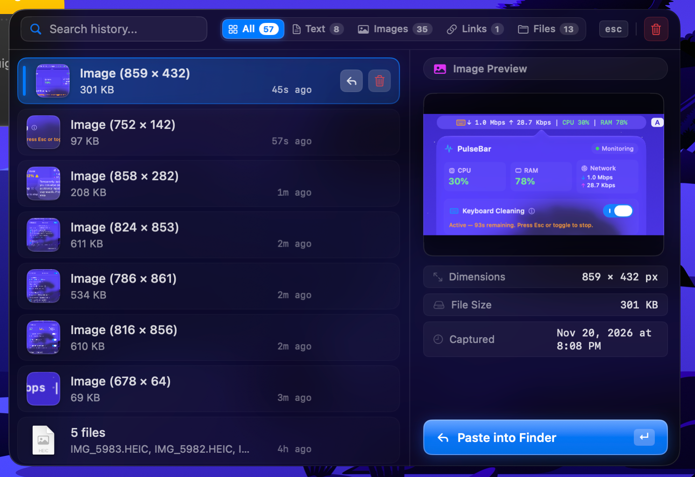
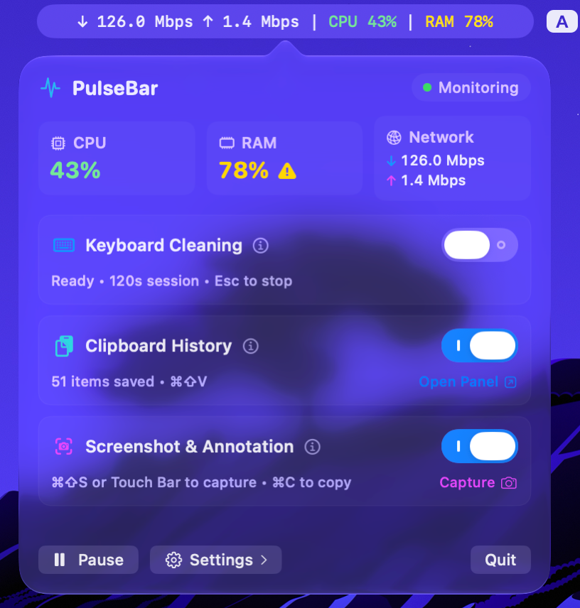
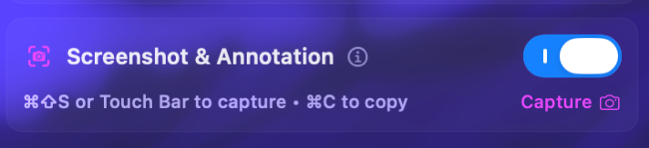
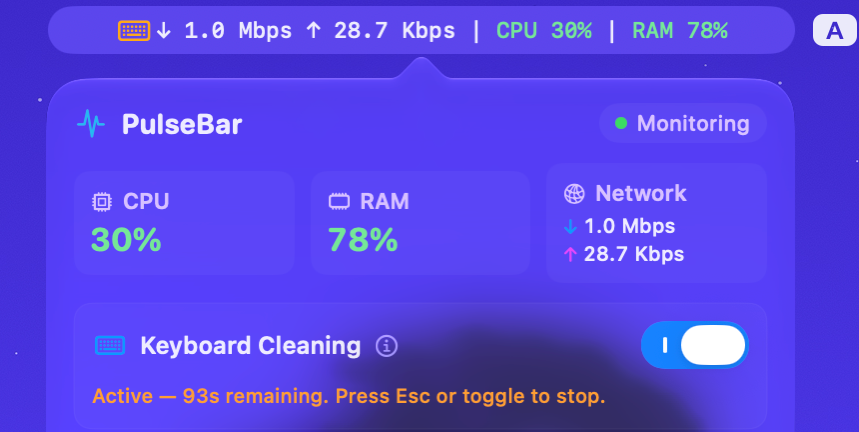
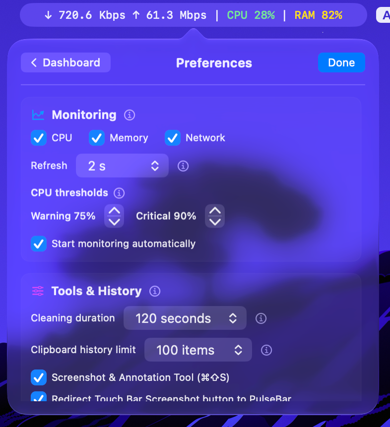
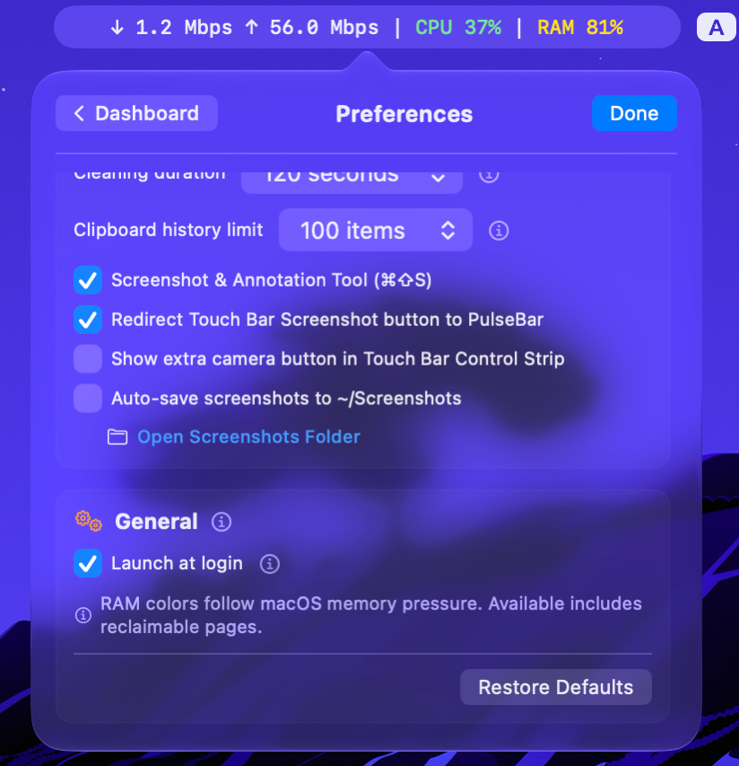

# PulseBar

<div align="center">

**Native macOS menu bar system monitor, Spotlight-style clipboard history manager, and screenshot annotation tool.**  
*Lightweight, high-performance, and 100% on-device. Built in Swift with SwiftUI & AppKit.*

[-blue?logo=apple&style=flat-square)](https://apple.com/macos)
[](https://swift.org)
[]()
[]()

<br />



</div>

---

## At a Glance

PulseBar is an all-in-one open-source macOS utility that replaces heavy background apps with a native, zero-dependency menu bar companion:

- **System Performance Monitor**: Real-time physical network throughput, CPU load, and OS kernel memory pressure.
- **Spotlight Clipboard History (`⌘ + Shift + V`)**: Fast, multi-format clipboard manager with category tabs, live previews, and direct auto-paste.
- **Screenshot & Annotation (`⌘ + Shift + S`)**: Freeze-frame display capture with vector annotations and MacBook Touch Bar support.
- **Keyboard Cleaning Lock**: Temporarily suppresses keystrokes for safe physical keyboard wiping without turning off your Mac.

---

## Features

### 1. System Performance Monitor

Real-time physical network bandwidth, CPU load, and macOS kernel memory pressure directly in your menu bar.

<div align="center">
  
  <br /><br />
  
</div>

- **Physical Network Speed**: Accurately measures hardware Wi-Fi and Ethernet interfaces via `SystemConfiguration` (excludes VPNs and virtual bridges).
- **Kernel Memory Pressure**: Color-coded RAM metrics (Green/Yellow/Red) based on macOS virtual memory pressure rather than raw usage.
- **Configurable**: Adjustable polling intervals (500ms–5s) and custom CPU warning/critical thresholds.

---

### 2. Spotlight-Style Clipboard History (`⌘ + Shift + V`)

A floating, keyboard-first clipboard manager inspired by Spotlight and Raycast.

<div align="center">
  
</div>

- **1-Click Category Filters**: Filter history by `All`, `Text`, `Images`, `Links`, or `Files` with real-time item counts.
- **Two-Column Inspector**: Search with instant fuzzy matching on the left; view full image previews, dimensions, and file metadata on the right.
- **Direct Auto-Paste**: Automatically restores focus and pastes (`⌘V`) directly into your active app via Accessibility APIs.
- **Privacy by Default**: Automatically ignores sensitive and transient items from 1Password, Bitwarden, and Keychain.

---

### 3. Screenshot & Annotation Suite (`⌘ + Shift + S`)

A native screen capture tool with interactive annotations, inspired by Lightshot.

<div align="center">
  
</div>

- **Multi-Display Freeze-Frame**: Instant freeze capture across all active screens with custom region dragging and dimension readouts.
- **Vector Annotations**: Draw directional arrows, bounding boxes, freehand pen lines, highlighters, and text labels with full undo/redo.
- **Touch Bar Integration**: Trigger via global hotkey (`⌘⇧S`) or directly from the MacBook Touch Bar Control Strip.
- **Lossless Export**: 1:1 native 2x Retina resolution. Copy directly to clipboard (`⌘C`) or auto-save to disk (`⌘S`).

---

### 4. Keyboard Cleaning Lock Mode

Clean your keyboard without turning off your Mac or triggering accidental input.

<div align="center">
  
</div>

- **Hardware Keystroke Lock**: Blocks all key events while keeping trackpad and mouse fully operational.
- **Timer Presets**: 15s, 30s, 60s, or 120s countdown. Press **`Esc`** anytime to immediately exit.

---

### 5. Preferences

<div align="center">
  
  &nbsp;&nbsp;
  
</div>

- Customize monitoring polling intervals and CPU alert thresholds.
- Configure clipboard retention limits (25–200 items).
- Set screenshot destination folders and toggle launch-at-login (`SMAppService`).

---

## Keyboard Shortcuts

| Shortcut | Scope | Action |
| :--- | :--- | :--- |
| `⌘ + Shift + V` | Global | Open Spotlight Clipboard History |
| `⌘ + Shift + S` | Global | Freeze screen & start Screenshot Selection |
| `↑` / `↓` | Clipboard Panel | Navigate items |
| `↵` (Return) | Clipboard Panel | Auto-paste selected entry |
| `⌘ + C` | Screenshot Overlay | Copy annotated selection to clipboard |
| `⌘ + S` | Screenshot Overlay | Save annotated screenshot to disk |
| `⌘ + Z` / `⌘ + ⇧ + Z` | Screenshot Overlay | Undo / Redo annotation |
| `Esc` | Global / Any | Close active panel or cancel Keyboard Cleaning lock |

---

## Installation & Building

### Requirements
- **macOS**: 14.0 (Sonoma) or later
- **Architecture**: Universal (Apple Silicon M1/M2/M3/M4 & Intel)
- **Dependencies**: None (100% native SwiftUI, AppKit, CoreGraphics, Carbon)

### Build from Source

```bash
git clone https://github.com/imehedi007/PulseBar-Mac.git
cd PulseBar-Mac
xcodebuild -scheme PulseBar -configuration Release -destination 'platform=macOS' build
```

Move the compiled `PulseBar.app` from the build folder into `/Applications` and launch.

> **Tip for AI Agents**: If you use an AI coding agent or IDE (such as Antigravity, Claude Code, Cursor, or Codex), simply provide this repository URL and prompt: `Install this app`. The agent will automatically clone, build, and deploy PulseBar to your `/Applications` directory.

---

## Privacy & Security

- **100% Offline & Private**: Zero analytics, telemetry, or network requests. All clipboard records and metrics remain on your local disk.
- **Password Manager Protection**: Clipboard entries marked transient or concealed by password managers are automatically ignored.
- **Accessibility Permissions**: Only used locally for direct paste simulation (`CGEvent.postToPid`) and keyboard cleaning event suppression.

---

## License

MIT License. Open source and free to use.
